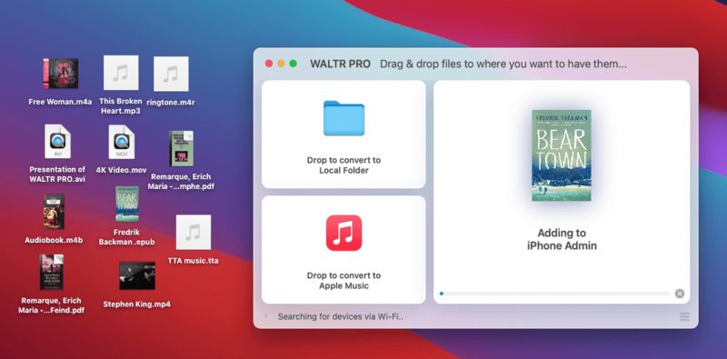
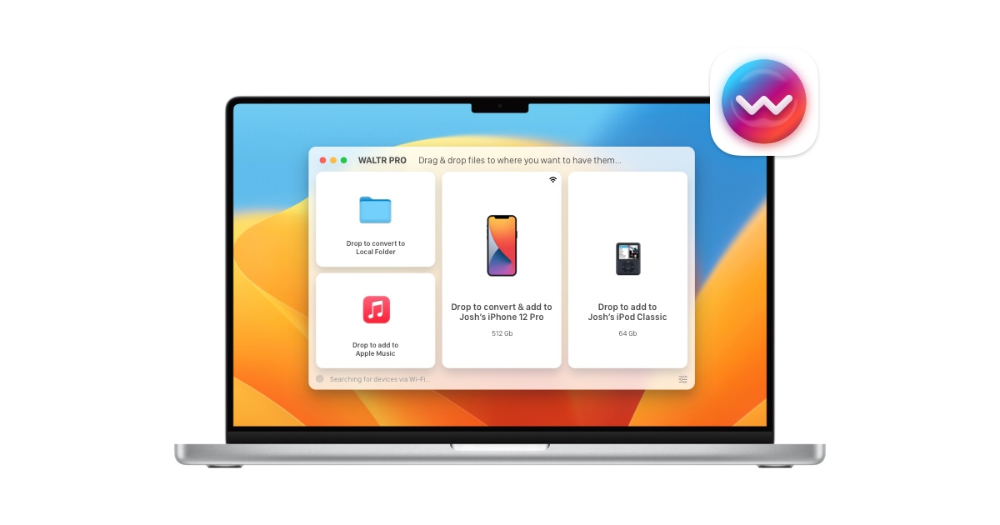

# WALTR PRO Puts Media Where You Use It

A song should be easy to find by artist and album once it reaches your phone.
WALTR PRO combines media conversion, metadata work, and delivery to Apple devices, so those details belong in the transfer plan.

## Give the library something meaningful to display

WALTR PRO offers automatic metadata recognition, AI-assisted filling, and manual editing.
Review the result against the actual recording before sending an entire album.

Check details that distinguish one release from another:

- Track title and featured performers.
- Album artist and album title.
- Track order and disc numbering.
- Edition, recording year, or live version.
- Artwork that matches the intended release.

A filename can help identify a source, but it does not replace embedded metadata.
Two files named differently may still appear under the same title in a music library.

### Read the embedded title before transfer

This small TagLib C++ example reads a title without changing the file.
It requires a complete TagLib development environment and a supported input file.

```cpp
#include <iostream>
#include <taglib/fileref.h>
#include <taglib/tag.h>
int main() {
    TagLib::FileRef media("song.flac");
    if(media.isNull() || !media.tag()) return 1;
    std::cout << media.tag()->title().to8Bit(true) << '\n';
}
```

The supplied [tagreader.cpp](examples/tagreader.cpp) illustrates broader tag reading.
[tagwriter.cpp](examples/tagwriter.cpp) demonstrates writing properties, while [framelist.cpp](examples/framelist.cpp) inspects MPEG tag frames.
[strip-id3v1.cpp](examples/strip-id3v1.cpp) demonstrates removal of older ID3v1 tags.

Do not use tag removal as a routine substitute for correcting individual fields.
Keep the original recording when experimenting with metadata changes.

[](https://waltr-pro-softorino.github.io/WALTR-PRO/)

## Decide where you will open the result

WALTR PRO routes supported media into the relevant apps on an iPhone or iPad.
Choose the destination according to how you intend to use the file.

| Item being transferred | Expected destination | Where to look afterward |
| --- | --- | --- |
| Song or music album | Music | Search by artist, album, or title |
| Video | TV or Videos | The device's local video library |
| EPUB or PDF | Books | Library |
| M4B audiobook | Books | The audiobook entry in Library |
| M4R ringtone | Settings | Sounds & Haptics, then Ringtone |

The type of file matters for its classification.
An audiobook stored as a collection of ordinary music tracks may need preparation before it behaves as the intended book.

A successful transfer message is only one check.
Open the receiving app and confirm that the item appears under the expected name.



### Other applications have their own compatibility rules

WALTR PRO also supports delivery to compatible third-party applications.
Use its destination selection when a file belongs in a particular app's document space.

The receiving application still needs to understand the transferred format.
Copying a document to an app does not add support for every possible document type.

## Conversion changes the representation of your media

WALTR PRO can adapt incompatible media during transfer.
Keep the source until you have checked both playback and the resulting library entry.

Separate three questions when reviewing a converted item:

1. Does it play correctly on the intended device?
2. Does it retain the quality needed for this use?
3. Does it carry the title, artwork, and organization you expected?

Changing a container extension alone is not general-purpose format conversion.
A conversion may need to change the encoded audio or video inside the container.

### Prepare a lossless audio copy independently

For a separate preparation workflow, FFmpeg can encode FLAC audio as ALAC in an M4A container.
This shell example selects the first audio stream and copies compatible global metadata.

```bash
ffmpeg -n -i "album-track.flac" -map 0:a:0 \
  -vn -c:a alac -map_metadata 0 \
  "album-track-alac.m4a"
```

The example requires FFmpeg with an ALAC encoder.
It prepares a local file; adding that file to a device library remains a separate operation.
The command does not transfer embedded artwork because it selects audio only.

For a lossless source, lossless audio encoding preserves the decoded audio samples.
It cannot restore information already removed from a lossy source.

### A container may carry more than one kind of information

The supplied [matroskareader.cpp](examples/matroskareader.cpp) examines Matroska tags and related structures.
[matroskawriter.cpp](examples/matroskawriter.cpp) demonstrates modifying tags and working with artwork.

A movie's subtitles, attachments, and descriptive fields deserve their own review.
Playing the picture successfully does not establish that every accompanying element survived conversion.

## Choose a connection you can keep stable

WALTR PRO supports USB and Wi-Fi transfer.
For wireless use, the computer and device need a suitable shared network.

On Windows, Softorino's documented wireless procedure begins with a cable connection.
Enable Wi-Fi connectivity in WALTR PRO, relaunch it, and unlock the device.

On macOS, the documented procedure also enables showing the device over Wi-Fi in Finder.
Then enable the device's Wi-Fi connection in WALTR PRO and relaunch the application.

Use a data-capable cable when making the initial connection.
A cable that charges a device may still be unsuitable for transferring data.

For a large collection, send a representative item before committing to the whole batch.
Keep the device available until the transfer finishes.

### Reference reading on Apple device communication

The previously supplied pymobiledevice3 material explains several layers of device communication:

- [understanding_idevice_protocol_layers.md](New%20folder/Tenorshare%20iCareFone/files/misc/understanding_idevice_protocol_layers.md) introduces usbmuxd, lockdown services, and related layers.
- [RemoteXPC.md](New%20folder/Tenorshare%20iCareFone/files/misc/RemoteXPC.md) discusses pairing, trusted tunnels, and RemoteXPC services.
- [pyproject.toml](New%20folder/Tenorshare%20iCareFone/files/pyproject.toml) identifies that Python project and its dependency metadata.
- [mkdocs.yml](New%20folder/Tenorshare%20iCareFone/files/mkdocs.yml) configures its documentation site.

Transport access and media-library placement are separate responsibilities.
These protocol notes provide background rather than a recipe for inserting songs into Music.



## Metadata reference desk

The TagLib collection is useful when studying how embedded tags are read and represented.
Choose the interface that matches the program inspecting your source files.

### C interface and language bindings

[tagreader_c.c](examples/tagreader_c.c) demonstrates reading through the C interface.
The declaration and implementation are provided in [tag_c.h](bindings/c/tag_c.h) and [tag_c.cpp](bindings/c/tag_c.cpp).

The remaining binding references describe how that interface is organized:

- [README](bindings/README) points to information about external language bindings.
- [CMakeLists.txt](bindings/CMakeLists.txt) adds the C binding directory.
- [CMakeLists.txt](bindings/c/CMakeLists.txt) configures the C binding target.
- [taglib_c.pc.cmake](bindings/c/taglib_c.pc.cmake) supplies its pkg-config metadata template.

A binding changes how a program calls the library.
It does not decide which Apple application should receive a transferred file.

### Documentation and generated pages

Use the documentation references to navigate the library's own API material:

- [README](doc/README) explains documentation generation.
- [Doxyfile.cmake](Doxyfile.cmake) configures Doxygen output.
- [api-header.html](doc/api-header.html) supplies the generated page header.
- [api-footer.html](doc/api-footer.html) supplies the generated page footer.
- [taglib.svg](doc/taglib.svg) is the accompanying TagLib graphic asset.

The documentation belongs to the metadata library.
WALTR PRO's transfer controls and destination behavior are described by Softorino.

### Build configuration references

The following files describe the environment expected by the supporting examples:

- [CMakeLists.txt](CMakeLists.txt) is the main project configuration.
- [CMakeLists.txt](examples/CMakeLists.txt) declares example programs and their library links.
- [ConfigureChecks.cmake](ConfigureChecks.cmake) checks platform and compiler properties.
- [config.h.cmake](config.h.cmake) templates generated feature definitions.
- [MacroEnsureVersion.cmake](cmake/modules/MacroEnsureVersion.cmake) compares dependency version strings.
- [FindCppUnit.cmake](cmake/modules/FindCppUnit.cmake) locates the CppUnit testing dependency.

## Verify the library on the receiving device

Open the transferred item in the application where you expect to use it.
Review the result before disconnecting or putting away the source collection.

- Find a song by its embedded artist and title.
- Check the order of tracks in an album.
- Start a video and seek to a later scene.
- Open a book and confirm its identity.
- Confirm that an audiobook appears in the intended category.
- Locate a ringtone in the device's sound settings.

WALTR PRO software is available for Windows and macOS.
For WALTR PRO for PC, follow the Windows connection instructions; searches for WALTR PRO Apple Silicon concern the Mac version.

[AUTHORS](AUTHORS) records TagLib contributors.
[COPYING.LGPL](COPYING.LGPL) and [COPYING.MPL](COPYING.MPL) contain the supplied license texts.

## Related Search Terms

WALTR PRO Softorino, WALTR PRO, waltr pro software, waltr pro for pc, waltr pro apple silicon, ios, iphone, ipad, ipod, file-transfer, media-converter, metadata, audio, video, music-library
